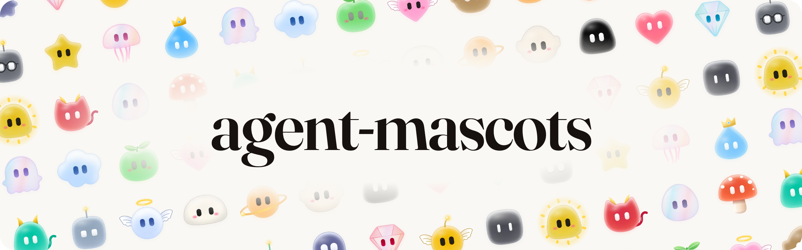

<p align="center">
  
</p>

<p align="center">
  <a href="https://github.com/comfycomputer/agent-mascots/actions/workflows/ci.yml"></a>
  
  
  <a href="LICENSE"></a>
</p>

**Animated mascots for your AI agents!** One web component, no dependencies, works with any frontend framework.

## Quick start
Install the package via npm:
```sh
npm install agent-mascots
```

Import the package:
```js
import 'agent-mascots'
```

Then, add the mascot to your application!
```html
<agent-mascot 
  shape="cloud"
  material="frost"
  mood="thinking"
></agent-mascot>
```

Visit the [**Playground**](https://comfycomputer.github.io/agent-mascots/) to customize the appearance of your agent mascot.

## Docs

- [Website and playground](https://comfycomputer.github.io/agent-mascots/): design a mascot and copy its code.
- [Usage](docs/USAGE.md): moods, wiring it to your agent, React, Vue, Svelte and Solid, shapes and
  materials, tracking, bundle size and custom shapes.
- [API reference](docs/API.md): every attribute, property, method, event and CSS hook.
- [Examples](examples): vanilla HTML, the frameworks, and a live agent over server-sent events.

## Licence

Created by [Kyle Oliveiro](https://github.com/kyleoliveiro) and released under the [MIT](LICENSE) license.
