# Usage

How to add a mascot to a page, connect it to your agent, and choose how it looks. For every
attribute, property, method, event and CSS hook, see the [API reference](API.md).

- [Install](#install)
- [Frameworks](#frameworks)
- [Moods](#moods)
- [Wire it to your agent](#wire-it-to-your-agent)
- [Shapes and materials](#shapes-and-materials)
- [Custom shapes](#custom-shapes)
- [Eye tracking](#eye-tracking)
- [Accessibility](#accessibility)
- [Bundle size](#bundle-size)
- [Browser support](#browser-support)
- [Development](#development)

## Install

Load the script from a CDN and add the tag:

```html
<script type="module" src="https://cdn.jsdelivr.net/npm/agent-mascots/dist/cdn.js"></script>

<agent-mascot shape="cloud" material="frost" mood="thinking"></agent-mascot>
```

Or, with a bundler, install the package and import `agent-mascots`:

```sh
npm install agent-mascots
```

Clicking a mascot pokes it: it squashes, winks and fires a `mascot-poke` event.

## Frameworks

### React 19

```jsx
import { useState } from 'react';
import 'agent-mascots';

export function Agent() {
  const [mood, setMood] = useState('thinking');
  return <agent-mascot shape="cloud" mood={mood} onmascot-poke={() => setMood('success')} />;
}
```

React 18 and earlier pass every prop as an attribute and can't listen for custom events. Use a ref
there instead.

### Vue

```vue
<script setup>
import { ref } from 'vue';
import 'agent-mascots';

const mood = ref('thinking');
</script>

<template>
  <agent-mascot shape="cloud" :mood="mood" @mascot-poke="mood = 'success'" />
</template>
```

Vue also needs to know that `agent-mascot` is a custom element:

```js
// vite.config.js
import vue from '@vitejs/plugin-vue';

const isCustomElement = (tag) => tag === 'agent-mascot';

export default {
  plugins: [vue({ template: { compilerOptions: { isCustomElement } } })],
};
```

### Svelte 5

```svelte
<script>
  import 'agent-mascots';

  let mood = $state('thinking');
</script>

<agent-mascot shape="cloud" {mood} onmascot-poke={() => (mood = 'success')}></agent-mascot>
```

### Events and properties

Frameworks bind the `mascot-poke` event and the `trackElement` property differently.
`trackElement` is the element whose pointer the eyes follow, and has no attribute.

| Framework | `mascot-poke` | `trackElement` |
|---|---|---|
| React 19 | `onmascot-poke={fn}` | `trackElement={el}` |
| Vue | `@mascot-poke="fn"` | `:trackElement="el"` (keep the camelCase) |
| Svelte 5 | `onmascot-poke={fn}` | `trackElement={el}` |
| Solid | `on:mascot-poke={fn}` | `prop:trackElement={el}` |

### TypeScript

To get types for the element in JSX and templates, import them once, for example in a `.d.ts`
file. This adds no code to your bundle, and only affects the frameworks you have installed.

```ts
import 'agent-mascots/jsx';
```

## Moods

Set `mood` to show what your agent is doing. The mascot animates smoothly from one mood to the
next.

<table>
  <tr>
    <td align="center"><picture><source media="(prefers-reduced-motion: reduce)" srcset="https://github.com/comfycomputer/agent-mascots/raw/main/docs/media/mood-idle-still.png">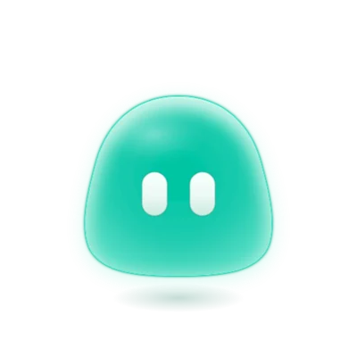</picture><br><code>idle</code><br>Nothing to do</td>
    <td align="center"><picture><source media="(prefers-reduced-motion: reduce)" srcset="https://github.com/comfycomputer/agent-mascots/raw/main/docs/media/mood-thinking-still.png">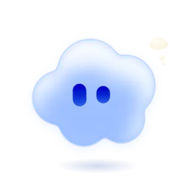</picture><br><code>thinking</code><br>The model has the prompt</td>
    <td align="center"><picture><source media="(prefers-reduced-motion: reduce)" srcset="https://github.com/comfycomputer/agent-mascots/raw/main/docs/media/mood-working-still.png">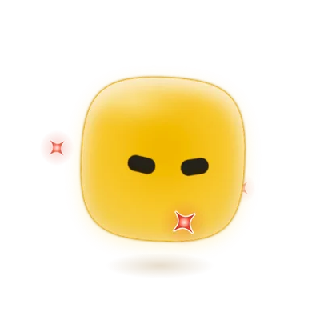</picture><br><code>working</code><br>A tool is running</td>
  </tr>
  <tr>
    <td align="center"><picture><source media="(prefers-reduced-motion: reduce)" srcset="https://github.com/comfycomputer/agent-mascots/raw/main/docs/media/mood-success-still.png">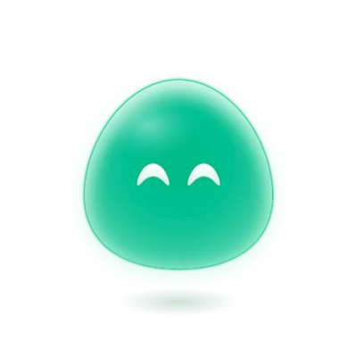</picture><br><code>success</code><br>Done</td>
    <td align="center"><picture><source media="(prefers-reduced-motion: reduce)" srcset="https://github.com/comfycomputer/agent-mascots/raw/main/docs/media/mood-error-still.png">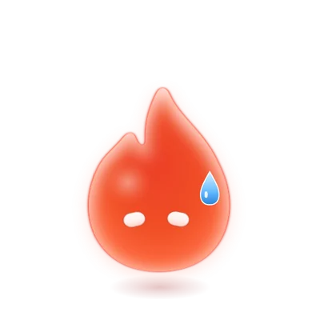</picture><br><code>error</code><br>Something failed</td>
    <td align="center"><picture><source media="(prefers-reduced-motion: reduce)" srcset="https://github.com/comfycomputer/agent-mascots/raw/main/docs/media/mood-waiting-still.png">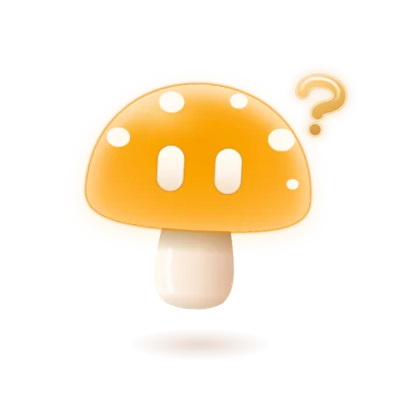</picture><br><code>waiting</code><br>It needs your approval</td>
  </tr>
  <tr>
    <td align="center"><picture><source media="(prefers-reduced-motion: reduce)" srcset="https://github.com/comfycomputer/agent-mascots/raw/main/docs/media/mood-listening-still.png">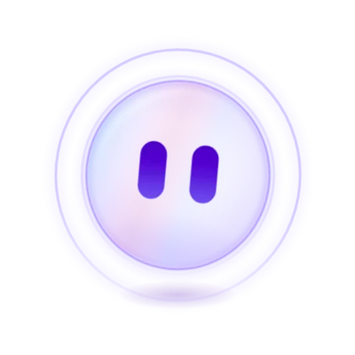</picture><br><code>listening</code><br>Someone is talking</td>
    <td align="center"><picture><source media="(prefers-reduced-motion: reduce)" srcset="https://github.com/comfycomputer/agent-mascots/raw/main/docs/media/mood-speaking-still.png">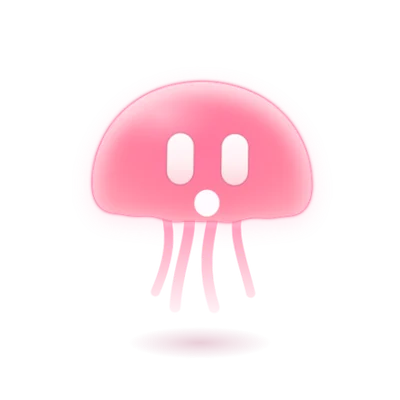</picture><br><code>speaking</code><br>Bind <code>level</code> to your audio</td>
    <td align="center"><picture><source media="(prefers-reduced-motion: reduce)" srcset="https://github.com/comfycomputer/agent-mascots/raw/main/docs/media/mood-sleeping-still.png">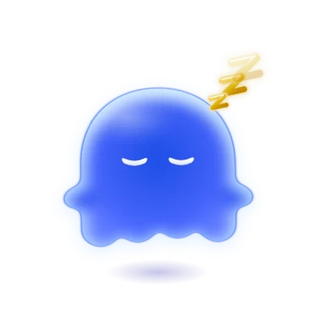</picture><br><code>sleeping</code><br>Session over</td>
  </tr>
</table>

## Wire it to your agent

Map each event from your agent to a mood. This example reads events from an `EventSource`, and
shows `error` if the connection drops:

```js
const MOODS = {
  start: 'thinking',
  tool: 'working',
  blocked: 'waiting',
  fail: 'error',
  done: 'success',
  idle: 'idle',
};

const mascot = document.querySelector('agent-mascot');
const events = new EventSource('/agent');

function onAgentEvent(type) {
  mascot.mood = MOODS[type] ?? 'idle';
}

events.onmessage = ({ data }) => {
  onAgentEvent(data);
  // A server ending the stream counts as a dropped connection, and a dropped one reconnects.
  if (data === 'done' || data === 'fail') events.close();
};
events.onerror = () => onAgentEvent('fail');
```

For a runnable version with a small Node server and a fake agent, see
[examples/sse](../examples/sse). There are also [minimal examples](../examples) for plain HTML,
React, Vue, Svelte and Solid.

Suggested moods for common agent states:

| Agent state | Mood |
|---|---|
| The prompt has reached the model | `thinking` |
| A tool is running | `working` |
| It needs your approval | `waiting` |
| A step failed, or the connection dropped | `error` |
| The task is finished | `success` |
| Someone is talking to it | `listening` |
| It's reading its answer aloud | `speaking` |
| Nothing is running | `idle` |
| The session is over | `sleeping` |

While `speaking`, the mouth moves to a built-in rhythm. To follow real audio instead, set `level`
to the current loudness, from 0 to 1:

```js
const mascot = document.querySelector('agent-mascot');

mascot.mood = 'speaking';
mascot.level = 0.6;
```

## Shapes and materials

<p align="center">
  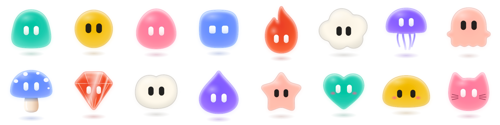
</p>

There are 16 shapes: `blob`, `orb`, `egg`, `squircle`, `flame`, `cloud`, `bell`, `ghost`, `cap`,
`gem`, `bean`, `drop`, `star`, `heart`, `mochi` and `cat`. You can also
[add your own](#custom-shapes).

Each shape comes in three materials: `glow`, `frost` and `glass`. With `frost`, the eyes are cut
out, so the background shows through them.

<p align="center">
  <picture>
    <source media="(prefers-reduced-motion: reduce) and (prefers-color-scheme: dark)" srcset="https://github.com/comfycomputer/agent-mascots/raw/main/docs/media/materials-still-dark.png">
    <source media="(prefers-reduced-motion: reduce)" srcset="https://github.com/comfycomputer/agent-mascots/raw/main/docs/media/materials-still-light.png">
    <source media="(prefers-color-scheme: dark)" srcset="https://github.com/comfycomputer/agent-mascots/raw/main/docs/media/materials-dark.webp">
    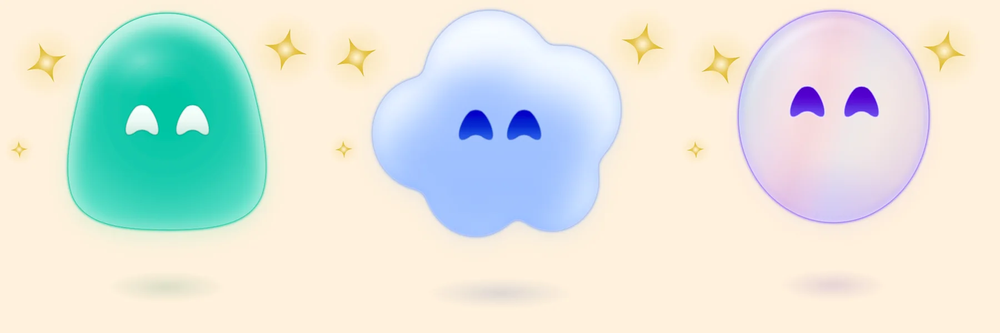
  </picture>
</p>

At 64px wide or smaller, a mascot switches to a simpler, flat drawing without blur filters, which
stays readable down to 16px. To choose one drawing at any size, set `detail` to `full` or `simple`.

Colours, eyes, accessories, proportions and movement each have their own attributes. They're all
listed in the [API reference](API.md).

## Custom shapes

A shape is SVG path data in a 240 × 240 box, centred on x = 120. `registerShape` validates the path
and throws a `TypeError` if it's malformed, so a bad path can't produce a clipped or invisible
mascot.

```js
import { registerShape } from 'agent-mascots';

registerShape('kite', {
  path: 'M120 50L180 120L120 190L60 120Z',
  eyes: { y: 120, w: 14, h: 24, gap: 14 },
  top: 50,
  bottom: 190,
  halfWidth: 60,
});
```

Then use it by name: `<agent-mascot shape="kite"></agent-mascot>`. All the options are in the
[API reference](API.md#exports).

## Eye tracking

<p align="center">
  <picture>
    <source media="(prefers-reduced-motion: reduce) and (prefers-color-scheme: dark)" srcset="https://github.com/comfycomputer/agent-mascots/raw/main/docs/media/tracking-still-dark.png">
    <source media="(prefers-reduced-motion: reduce)" srcset="https://github.com/comfycomputer/agent-mascots/raw/main/docs/media/tracking-still-light.png">
    <source media="(prefers-color-scheme: dark)" srcset="https://github.com/comfycomputer/agent-mascots/raw/main/docs/media/tracking-dark.webp">
    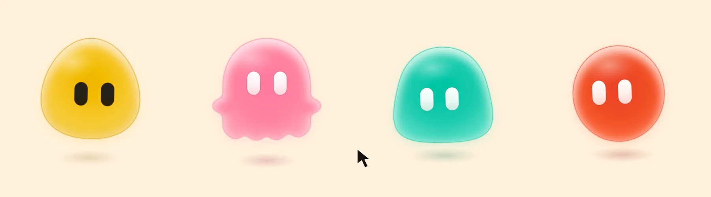
  </picture>
</p>

By default, the eyes follow the pointer while it's over the mascot. Set `track` to follow the
pointer anywhere in the window, over a specific element, or not at all. Mascots that track the same
target share one event listener.

```html
<agent-mascot track="window"></agent-mascot>
<agent-mascot track="#prompt"></agent-mascot>
<agent-mascot track="none"></agent-mascot>

<input id="prompt" placeholder="Hover me">
```

To make the mascot look at a specific point, call `lookAt()` with viewport coordinates. It takes
priority over every other input, and it's the only input a `sleeping` mascot responds to. Call
`lookAway()` to release it.

```js
const mascot = document.querySelector('agent-mascot');

mascot.lookAt(400, 300);
mascot.lookAway();
```

On phones, the eyes can follow the device's tilt. Add the `gyro` attribute, or call `enableGyro()`
from a click handler. iOS only asks for permission in response to a user gesture.

```html
<agent-mascot id="tilty"></agent-mascot>
<button id="tilt">Enable tilt</button>

<script type="module">
  const mascot = document.querySelector('#tilty');

  document.querySelector('#tilt').addEventListener('click', async () => {
    const state = await mascot.enableGyro();
    console.log(state); // 'granted', 'denied' or 'unsupported'
  });
</script>
```

When several inputs are active, the eyes follow the first of: `lookAt()`, a pointer that moved in
the last 2 seconds, the gyro, and the mood's own movement.

## Accessibility

- A mascot has `role="img"`. Its name comes from `label`, or defaults to `Assistant, <mood>`.
- Mood changes aren't announced. If they matter, show them in your own UI too.
- An `aria-label` you set yourself is kept. For a purely decorative mascot, use
  `role="presentation"` or `aria-hidden="true"`.
- A mascot can only be focused if you give it a `tabindex`. When focused, Enter and Space poke it.
- With `prefers-reduced-motion`, looping animations stop and each mood is a still pose. The eyes
  jump instead of moving smoothly, and a poke still makes it wink. The animations in these docs
  switch to still images too.
- With `forced-colors`, the mascot is drawn as an outline in system colours.

## Bundle size

Minified and gzipped, measured with `bun run size` on a production build:

| Import | Contents | Size |
|---|---|---|
| `agent-mascots` | The element, every shape and every accessory | 28.2 kB |
| `agent-mascots/core` | The element and one fallback shape, with no accessories | 18.7 kB |
| `agent-mascots/cdn` | Everything in one file, for `<script type="module">` | 28.0 kB |

There are no runtime dependencies. To ship less, import `agent-mascots/core` and add only the
shapes and accessories you use. If a mascot uses a shape that hasn't loaded yet, it updates when the
shape arrives.

```js
import 'agent-mascots/core';
import 'agent-mascots/shapes/orb';
import 'agent-mascots/accessories/ears';
```

| Other imports | Contents |
|---|---|
| `agent-mascots/shapes/<name>` | One shape. Importing it registers it. |
| `agent-mascots/accessories/<name>` | One accessory. Importing it registers it. |
| `agent-mascots/jsx` | Types only (see [TypeScript](#typescript)) |
| `agent-mascots/custom-elements.json` | The custom elements manifest |

The package is ESM-only. It's safe to import on a server: the tag renders as a plain element and
upgrades in the browser.

## Browser support

The tests run in Playwright's desktop builds of three browser engines. These are the versions
tested. Older versions haven't been tested.

| Engine | Version |
|---|---|
| Chromium | 151.0.7922.34 |
| Firefox | 153.0 |
| WebKit | 26.5 |

The library targets ES2022 and needs custom elements and shadow DOM. Two features are optional,
and their fallbacks are tested:

- Without relative colour syntax (`oklch(from ...)`), mascots are drawn in flat colours.
- Without constructable stylesheets, styles are added in a `<style>` element.

It hasn't been tested on real Safari, iOS or Android devices yet. Gyro tracking in particular has
only been tested with simulated device events.

## Development

```sh
bun install
bun run build
bun run test
bun run site
```

`bun run site` starts the landing page and the playground, where you can design a mascot and copy
its code. The images in these docs are rendered from the component by `scripts/media/capture.mjs`.
